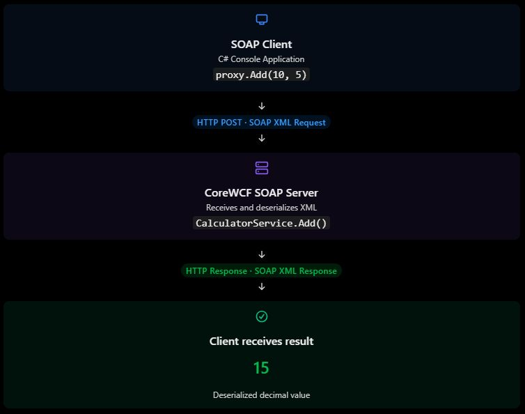

# Soap Training Project

A good way to learn SOAP APIs in C# is to build a complete solution with two separate applications:

1. SOAP Server: Exposes SOAP operations and processes incoming XML requests.
2. SOAP Client: Sends SOAP requests to the server and reads XML responses.

We'll build a small Calculator SOAP API with Add, Subtract, Multiply, and Divide operations.

## 1. Technology selection

We'll use modern .NET 10 with the following libraries:

|Component|Technology|
|-|-|
|Server|C# Console / ASP.NET Core hosting|
|SOAP framework|CoreWCF 1.9.1|
|Client|C# Console Application|
|Client library|System.ServiceModel.Http|
|SOAP binding|BasicHttpBinding|
|Protocol|SOAP 1.1 over HTTP|
|Metadata|WSDL|

Why these libraries?
- CoreWCF allows you to host SOAP services in modern .NET applications.
- System.ServiceModel.Http provides the WCF client functionality needed to call SOAP services.
- BasicHttpBinding is a good starting point because it uses standard SOAP over HTTP and is suitable for interoperability.

## 2. Solution structure

```
SoapTraining/
│
├── SoapServer/
│   ├── Program.cs
│   ├── ICalculatorService.cs
│   ├── CalculatorService.cs
│   └── SoapServer.csproj
│
└── SoapClient/
    ├── Program.cs
    ├── ICalculatorService.cs
    └── SoapClient.csproj
```

The two applications are independent. The client only needs to know the SOAP contract and the server endpoint address.

## 3. Build the SOAP server

The server will listen on port 8080.

### Step 3.1 — Install the NuGet package

Inside the SoapServer project:

```bash
dotnet add package CoreWCF.Http --version 1.9.1
```

### Step 3.2 — Define the service contract

Create ICalculatorService.cs:

```csharp
using CoreWCF;

namespace SoapServer;

[ServiceContract(Name = "CalculatorService", Namespace = "urn:training:calculator")]
public interface ICalculatorService
{
    [OperationContract]
    decimal Add(decimal a, decimal b);

    [OperationContract]
    decimal Subtract(decimal a, decimal b);

    [OperationContract]
    decimal Multiply(decimal a, decimal b);

    [OperationContract]
    decimal Divide(decimal a, decimal b);
}
```

What are these attributes?

- [ServiceContract]: Defines the SOAP service interface.
- [OperationContract]: Makes a method available to SOAP clients.
- Name: Defines the contract name exposed through WSDL.
- Namespace: Defines the XML namespace used in SOAP messages.

Think of this interface as the agreement between the server and client.

### Step 3.3 — Implement the service

Create CalculatorService.cs:

```csharp
using CoreWCF;

namespace SoapServer;

public sealed class CalculatorService : ICalculatorService
{
    public decimal Add(decimal a, decimal b)
    {
        Console.WriteLine($"Add({a}, {b})");
        return a + b;
    }

    public decimal Subtract(decimal a, decimal b)
    {
        Console.WriteLine($"Subtract({a}, {b})");
        return a - b;
    }

    public decimal Multiply(decimal a, decimal b)
    {
        Console.WriteLine($"Multiply({a}, {b})");
        return a * b;
    }

    public decimal Divide(decimal a, decimal b)
    {
        Console.WriteLine($"Divide({a}, {b})");

        if (b == 0)
        {
            throw new FaultException(
                "The divisor cannot be zero.");
        }

        return a / b;
    }
}
```

Notice that the implementation contains ordinary C# methods. CoreWCF takes care of receiving SOAP messages, deserializing XML into C# parameters, invoking the methods, and serializing their results.

We also introduced FaultException. This allows the service to return a SOAP Fault when something goes wrong.

### Step 3.4 — Configure the SOAP server

Create Program.cs:

```csharp
using CoreWCF;
using CoreWCF.Configuration;
using CoreWCF.Channels;
using CoreWCF.Description;
using SoapServer;

var builder = WebApplication.CreateBuilder(args);

// Configure the HTTP address
builder.WebHost.UseUrls("http://localhost:8080");

// Register SOAP services and WSDL support
builder.Services.AddServiceModelServices();
builder.Services.AddServiceModelMetadata();

var app = builder.Build();

// Register the SOAP service endpoint
app.UseServiceModel(serviceBuilder =>
{
    serviceBuilder
        .AddService<CalculatorService>()
        .AddServiceEndpoint<CalculatorService, ICalculatorService>(
            new BasicHttpBinding(),
            "/CalculatorService/basicHttp");
});

// Enable WSDL metadata
var metadataBehavior =
    app.Services.GetRequiredService<ServiceMetadataBehavior>();

metadataBehavior.HttpGetEnabled = true;

Console.WriteLine("SOAP Server Started!");
Console.WriteLine(
    "Endpoint: http://localhost:8080/CalculatorService/basicHttp");

Console.WriteLine(
    "WSDL: http://localhost:8080/CalculatorService/basicHttp?wsdl");

await app.RunAsync();
```

One important detail: this is still an executable console application. We use ASP.NET Core and Kestrel internally to host the SOAP HTTP endpoint.

### Step 3.5 — Start the server

```bash
dotnet run --project SoapServer
```

You should see:

```bash
SOAP Server Started!

Endpoint:
http://localhost:8080/CalculatorService/basicHttp

WSDL:
http://localhost:8080/CalculatorService/basicHttp?wsdl
```

You can open the WSDL address in your browser to inspect the service contract.

(Server ready)

## 4. Build the SOAP client

Now let's create another C# Console Application.

### Step 4.1 — Install the NuGet package

Inside SoapClient:

```bash
dotnet add package System.ServiceModel.Http --version 10.1.0
```

This provides the WCF client functionality required for HTTP-based SOAP communication.

### Step 4.2 — Define the client contract

Create ICalculatorService.cs:

```csharp
using System.ServiceModel;

namespace SoapClient;

[ServiceContract(Name = "CalculatorService", Namespace = "urn:training:calculator")]
public interface ICalculatorService
{
    [OperationContract]
    decimal Add(decimal a, decimal b);

    [OperationContract]
    decimal Subtract(decimal a, decimal b);

    [OperationContract]
    decimal Multiply(decimal a, decimal b);

    [OperationContract]
    decimal Divide(decimal a, decimal b);
}
```

Notice the difference:

|Server|Client|
|-|-|
|using CoreWCF;|using System.ServiceModel;|
|ServiceContract|ServiceContract|
|OperationContract|OperationContract|


The attributes come from different libraries, but the contract name, namespace, operation names, and data types must match.

### Step 4.3 — Implement the client

Create Program.cs:

```csharp
using System.ServiceModel;
using SoapClient;

const string endpointUrl = "http://localhost:8080/CalculatorService/basicHttp";

// Configure SOAP binding
var binding = new BasicHttpBinding(BasicHttpSecurityMode.None)
{
    OpenTimeout = TimeSpan.FromSeconds(10),
    CloseTimeout = TimeSpan.FromSeconds(10),
    SendTimeout = TimeSpan.FromSeconds(30),
    ReceiveTimeout = TimeSpan.FromSeconds(30),
    MaxReceivedMessageSize = 64 * 1024
};

// Define endpoint
var endpoint = new EndpointAddress(endpointUrl);

// Create client factory
var factory = new ChannelFactory<ICalculatorService>(binding, endpoint);

IClientChannel? channel = null;

try
{
    factory.Open();

    // Create SOAP client proxy
    ICalculatorService proxy = factory.CreateChannel();

    channel = (IClientChannel)proxy;
    channel.Open();

    Console.WriteLine("Connected to SOAP service!\n");

    // Call SOAP operations
    Console.WriteLine($"10 + 5 = {proxy.Add(10m, 5m)}");

    Console.WriteLine($"10 - 5 = {proxy.Subtract(10m, 5m)}");

    Console.WriteLine($"10 * 5 = {proxy.Multiply(10m, 5m)}");

    Console.WriteLine($"10 / 5 = {proxy.Divide(10m, 5m)}");

    // Test SOAP Fault handling
    try
    {
        proxy.Divide(10m, 0m);
    }
    catch (FaultException fault)
    {
        Console.WriteLine($"\nSOAP Fault received: {fault.Message}");
    }

    channel.Close();
    factory.Close();
}
catch (Exception ex)
{
    channel?.Abort();
    factory.Abort();

    Console.WriteLine($"SOAP communication failed: {ex.Message}");
}
```

### Step 4.4 — Start the client

Keep the server running in the first terminal.

Open another terminal:

```bash
dotnet run --project SoapClient
```

Expected client output:

```csharp
Connected to SOAP service!

10 + 5 = 15
10 - 5 = 5
10 * 5 = 50
10 / 5 = 2

SOAP Fault received: The divisor cannot be zero.
```

And the server terminal should show the incoming method calls.

(Client connected)

## 5. Understand what actually happens during a SOAP call

This is probably the most important part of your training.

When your client executes:

```csharp
decimal result = proxy.Add(10m, 5m);
```

It looks like an ordinary C# method call. However, behind the scenes, the WCF client creates an XML SOAP request and sends it to the server over HTTP.

A simplified SOAP request looks like this:

SOAP request:

```xml
<?xml version="1.0" encoding="utf-8"?>
<soap:Envelope
    xmlns:soap="http://schemas.xmlsoap.org/soap/envelope/">

    <soap:Body>
        <Add xmlns="urn:training:calculator">
            <a>10</a>
            <b>5</b>
        </Add>
    </soap:Body>

</soap:Envelope>
```

The server receives the XML, identifies the Add operation, executes the C# method, and returns another XML message.

SOAP response:

```xml
<?xml version="1.0" encoding="utf-8"?>

<soap:Envelope
    xmlns:soap="http://schemas.xmlsoap.org/soap/envelope/">

    <soap:Body>
        <AddResponse xmlns="urn:training:calculator">
            <AddResult>15</AddResult>
        </AddResponse>
    </soap:Body>

</soap:Envelope>
```

The client then converts the XML response into a C# decimal value.

This is the fundamental difference between calling a local C# method and calling a remote SOAP API.

## 6. Understand the complete communication flow



## 7. Your practical training exercises

Start by getting the Calculator example running, then move to complex objects, collections, and custom SOAP Faults. These are the concepts that will give you a solid foundation for working with real-world enterprise SOAP integrations.

For further reference, the official CoreWCF getting-started walkthrough and Microsoft WCF client documentation are particularly useful.